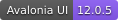

# Google Flow Custom

<p align="center">
  
</p>

<p align="center">
  <strong>Google Flow(flow.google.com) 전용 데스크톱 창 뷰어 & AI 에이전트 자동화 도구</strong><br>
  로그인 세션 영구 유지 · 생성물 전용 다운로드 폴더 · 사용자 CSS/JS 주입 · CDP 기반 MCP 서버 탑재
</p>

<p align="center">
  
  
  
  
  
</p>

---

## 💡 개발 배경

[Google Flow](https://flow.google.com/)는 Veo, Imagen 3, Nano Banana 등 최신 생성 모델로 고품질 영상과 이미지를 제작하는 Google의 AI 크리에이티브 스튜디오입니다.

하지만 일반 웹 브라우저에서 작업할 경우:
- 다른 웹 서핑 탭들과 섞여 프로젝트 창을 찾기 번거롭고
- 생성된 고화질 결과물이 일반 다운로드 폴더에 다른 파일들과 무질서하게 뒤섞이며
- 브라우저 쿠키 삭제나 프로필 전환 시 로그인이 풀리는 불편함이 있습니다.

**Google Flow Custom**은 [YouTube Studio Custom](https://github.com/magjangin/youtube-studio-tool)과 동일한 아키텍처로 설계되어, Flow를 독립 데스크톱 앱으로 쾌적하게 구동하고 필요한 화면 수정 및 에이전트 자동화 파이프라인을 완전하게 제공합니다.

---

## ✨ 핵심 기능

- 🪟 **독립 데스크톱 앱 창**: 복잡한 브라우저 UI 없이 `https://flow.google.com/` 작업 화면에 온전히 집중할 수 있는 깔끔한 독립 창을 제공합니다.
- 🔑 **로그인 세션 영구 유지 (Profile Isolation)**: 앱 전용 사용자 데이터 프로필(`%LocalAppData%\GoogleFlowCustom\WebView2`)을 사용하여 한 번 로그인하면 세션이 영구 유지되며, 평소 사용하는 메인 브라우저와 완벽히 격리됩니다.
- 📥 **생성물 전용 다운로드 폴더**: Flow에서 생성하고 다운로드한 고화질 이미지와 영상은 형제 도구 규격에 따라 전용 폴더에 자동 분리 저장됩니다:
  ```text
  %USERPROFILE%\Downloads\GoogleFlow_Downloads
  ```
- ⚡ **깜빡임 없는 사용자 스크립트/스타일 주입**: WebView2의 `AddScriptToExecuteOnDocumentCreatedAsync`를 통해 DOM 파싱 시점에 [`Scripts/flow-custom.js`](google%20flow%20custom/Scripts/flow-custom.js)를 주입합니다. SPA 화면 전환 시에도 스타일이 안정적으로 유지됩니다.
- 🤖 **Antigravity / Claude Code MCP 서버 내장 (`mcp/index.mjs`)**: Chrome DevTools Protocol(CDP, 포트 `9334`)을 통해 코딩 에이전트가 직접 Flow를 제어할 수 있습니다:
  - `flow_launch`: 전용 앱 실행 및 CDP 세션 연결
  - `flow_status`: 화면 상태, URL 및 로그인 여부 확인
  - `flow_type`: ProseMirror 에디터 호환 텍스트 입력 및 생성 시작(`submit: true`)
  - `flow_click`: Angular / Material Button 대응 물리 마우스 이벤트(`Input.dispatchMouseEvent`) 좌표 클릭
  - `flow_upload_media`: Image-to-Image 합성을 위한 로컬 소재 DataTransfer 일괄 업로드
  - `flow_navigate`: Flow 창 안에서 URL 이동 (프로젝트 열기 등)
  - `flow_eval`: Flow 페이지 콘텍스트에서 JavaScript 실행 (DOM 조사·세부 조작)
  - `flow_generate_typography`: 유튜브 썸네일 & 리듬게임 커스텀 차트 전용 2단 와이드 네온 타이포그래피 자동 생성 (하단/상단 **가운데** 배치, 위치·여백 지시가 항상 같은 방향)
  - `flow_screenshot`: 실시간 생성 상태 모니터링 캡처
  - `flow_get_downloads`: 생성물 자동 수집 및 로컬 동기화
  - `flow_download_images`: 현재 화면의 생성 이미지를 원하는 파일명으로 일괄 다운로드 + 워터마크 자동 제거
  - `flow_remove_watermarks`: 파일/폴더 단위 워터마크 제거 — **실제로 찍힌 요소(별·AI 캡슐)만** 지우고, 없으면 이미지를 건드리지 않음

> 💡 **타이포그래피 생성 전 준비:** `flow_generate_typography`는 현재 열린 프로젝트의 프롬프트 창에 지시문을 넣고 생성만 누릅니다. 먼저 새 프로젝트(또는 새 세션)를 열고 `flow_upload_media`로 원본을 올린 뒤, 프롬프트 창의 `+`(소재 추가)에서 그 이미지를 참조 칩으로 붙여야 원화가 보존됩니다(Image-to-Image). 순서는 [AGENTS.md](AGENTS.md) 14절.
- 🛠️ **DevTools(F12) 내장**: 우클릭 "검사" 또는 F12 키로 언제든 실제 DOM을 열람하고 디버깅할 수 있습니다.

---

## 🛠️ 기술 스택

- **프레임워크**: [.NET 10](https://dotnet.microsoft.com/)
- **UI 툴킷**: [Avalonia UI 12.0.5](https://avaloniaui.net/) + `Avalonia.Controls.WebView 12.0.1`
- **웹 런타임**: [Microsoft.Web.WebView2 1.0.3124.44](https://developer.microsoft.com/microsoft-edge/webview2/) (Chromium)
- **에이전트 제어**: Node.js 내장 WebSocket 기반 Chrome DevTools Protocol (CDP)
- **대상 OS**: Windows 10 / 11 (64-bit)

---

## 🚀 시작하기

### 사전 요구 사항
- Windows 10 / 11 (x64)
- [.NET 10.0 SDK](https://dotnet.microsoft.com/download)
- Microsoft Edge WebView2 Runtime (최신 Windows에 기본 탑재)

### 빌드 및 실행

```powershell
# 저장소 클론
git clone https://github.com/magjangin/google-flow-custom.git
cd google-flow-custom

# 개발 모드 실행
dotnet run --project "google flow custom/google flow custom.csproj"

# 배포용 단일 실행 파일(Single-File) 빌드 → publish\win-x64\google flow custom.exe
dotnet publish "google flow custom/google flow custom.csproj" `
  -c Release -r win-x64 --self-contained true `
  -p:PublishSingleFile=true `
  -p:IncludeNativeLibrariesForSelfExtract=true `
  -p:DebugType=none `
  -o "publish/win-x64"
```

---

## 🤖 MCP 서버 설정 (AI 에이전트 연동)

Antigravity 또는 Claude Code에서 Google Flow를 자율 조종할 수 있도록 에이전트 MCP 설정에 추가할 수 있습니다:

```json
{
  "mcpServers": {
    "google-flow-custom": {
      "command": "node",
      "args": ["H:/source/repos/google flow custom/mcp/index.mjs"]
    }
  }
}
```

Claude Code에서는 명령 한 줄로 사용자 범위(모든 프로젝트)에 등록할 수 있습니다. 등록 후 새 세션부터 도구가 보입니다.

```powershell
claude mcp add -s user google-flow-custom -- node "H:/source/repos/google flow custom/mcp/index.mjs"
```

워터마크 제거(`flow_remove_watermarks`, `flow_download_images`)는 PATH의 `python`으로 `Scripts/remove_watermark.py`를 실행하므로 **Python 3 + `opencv-python` + `numpy`**가 필요합니다.

---

## 📂 프로젝트 구조

```text
google-flow-custom/
├── google flow custom/
│   ├── App.axaml (.cs)             # Avalonia 애플리케이션 수명 주기
│   ├── MainWindow.axaml (.cs)      # 메인 윈도우 레이아웃 및 뷰어 바인딩
│   ├── GoogleFlowWebView.cs        # WebView2 환경 구성 (프로필, 다운로드, 스크립트 주입)
│   ├── Scripts/
│   │   ├── flow-custom.js          # 사용자 정의 CSS/JS 주입 스크립트 (임베디드 리소스)
│   │   ├── remove_watermark.py     # 워터마크 감지(요소별 고정 위치 상관) + 인페인팅 복원
│   │   └── wm_templates/
│   │       └── ai_capsule_hp.png   # 실제 "AI" 캡슐 워터마크의 하이패스 템플릿 (감지용)
│   └── Assets/
│       └── icon.png / icon.ico     # 애플리케이션 아이콘
├── mcp/
│   └── index.mjs                   # CDP 기반 Antigravity/Claude Code MCP 서버
├── publish/win-x64/                # 단일 실행 파일 빌드 산출물
├── docs/badges/                    # 로컬 렌더링용 SVG 배지
├── AGENTS.md                       # 멀티 에이전트 인수인계 문서
└── README.md                       # 메인 소개 문서
```

---

## 📜 라이선스 및 고지 사항

- Google Flow 및 관련 생성 AI 모델은 Google의 고유 상표 및 서비스입니다.
- 본 프로젝트는 Google과 공식적인 관련이 없으며, 개인 작업 편의를 위해 개발된 비공식 오픈소스 도구입니다.
- 설계 의도와 트러블슈팅 히스토리는 [AGENTS.md](AGENTS.md)를 참고하세요.
